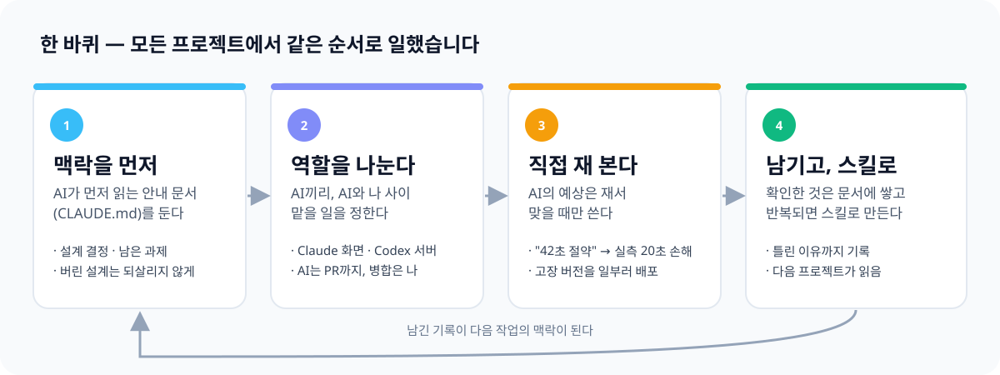
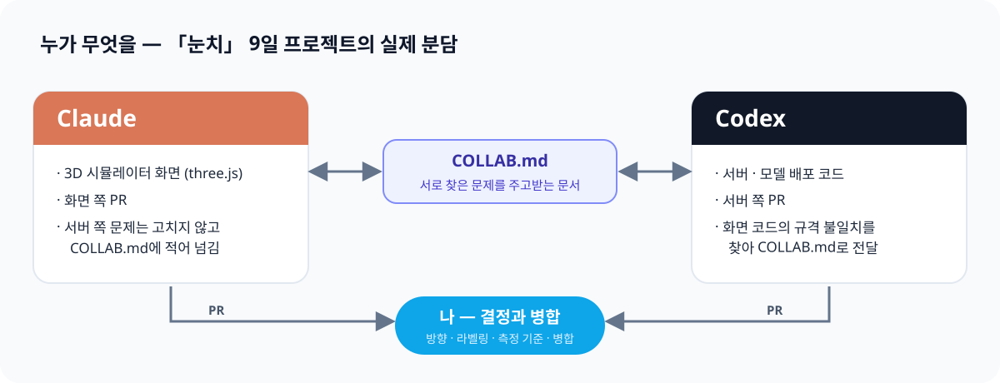
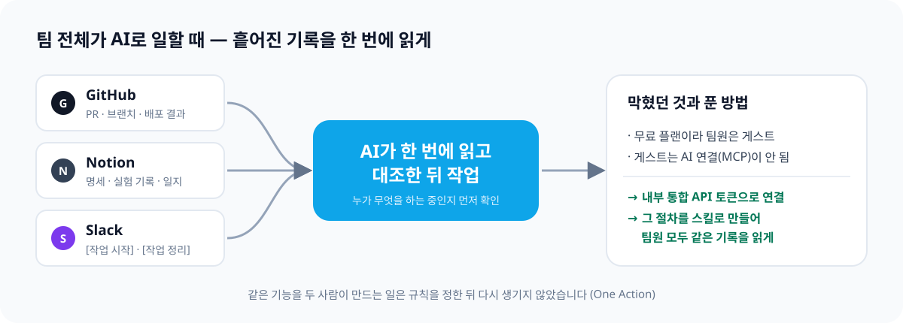

<a name="readme-top"></a>

<p align="center">
  
</p>

<p align="center">
  
  
  
  
</p>

<p align="center">
  <a href="https://faitruee.github.io/ai-workflow/"><b>소개 페이지</b></a> ·
  <a href="#-설치">설치</a> ·
  <a href="#-처음이라면">처음이라면</a> ·
  <a href="#-스킬-12종">스킬 12종</a> ·
  <a href="#-일하는-방식">일하는 방식</a> ·
  <a href="#-프로젝트에서-실제로-한-것">프로젝트 사례</a> ·
  <a href="#-양식">양식</a>
</p>

---

AI 코딩 도구는 코드를 빨리 써 줍니다.

그만큼 **확인하지 않은 예상이 사실처럼 문서에 적히기도 쉽습니다.**

이 저장소는 프로젝트마다 그 문제를 겪으며 굳힌 규칙과,<br>
그 규칙을 Claude Code가 매번 따르도록 옮긴 **스킬 12종 · 양식 2종**을 모은 것입니다.

> **AI에게는 초안과 구현을 맡기고,**<br>
> **방향 · 기준 · 확인 · 병합은 제가 합니다.**

🌐 **한눈에 보기** — 스킬 12종을 눌러 펼쳐 보는 소개 페이지: **[faitruee.github.io/ai-workflow](https://faitruee.github.io/ai-workflow/)**

<br>

## ⚡ 설치

Claude Code에서 두 줄이면 됩니다.

```text
/plugin marketplace add FAITRUEE/ai-workflow
/plugin install ai-workflow@ai-workflow
```

설치가 끝나면 **평소 말투로 부탁하기만 하면** 맞는 스킬이 알아서 켜집니다.<br>
(예: *"이거 진짜 되는 거 맞아? 확인해 봐"*)

<details>
<summary><b>업데이트 · 삭제 · 플러그인 없이 쓰기</b></summary>

<br>

**업데이트**

```text
/plugin marketplace update ai-workflow
```

**삭제**

```text
/plugin uninstall ai-workflow@ai-workflow
```

**플러그인 없이 쓰기** — 필요한 스킬 폴더만 `~/.claude/skills/`에 복사합니다.

```bash
git clone https://github.com/FAITRUEE/ai-workflow.git
cp -r ai-workflow/skills/assumption-check ~/.claude/skills/
```

</details>

**필요한 것**

- Claude Code
- 스크립트가 든 스킬만 Python 3
  - `oof-error-analysis` → `numpy` · `pandas`
  - `notion-team-hub` → 표준 라이브러리만 (추가 설치 없음)

<br>

## 🚀 처음이라면

12개를 다 볼 필요는 없습니다. 지금 하는 일에 맞는 것부터 고르세요.

| 지금 상황 | 먼저 써 볼 스킬 |
|---|---|
| 혼자 개발 중이고, AI가 "됐다"고 하는 게 불안하다 | [`assumption-check`](skills/assumption-check/SKILL.md) · [`api-verify`](skills/api-verify/SKILL.md) |
| 팀 프로젝트를 막 시작한다 | [`github-team-setup`](skills/github-team-setup/SKILL.md) · [`notion-team-hub`](skills/notion-team-hub/SKILL.md) · [`slack-worklog`](skills/slack-worklog/SKILL.md) |
| 분류 대회 · 실험에서 점수가 안 오른다 | [`oof-error-analysis`](skills/oof-error-analysis/SKILL.md) |
| 노션 명세 · README가 지금 코드와 맞는지 모르겠다 | [`doc-drift-check`](skills/doc-drift-check/SKILL.md) |
| 끝난 팀 프로젝트를 이력서 · 포트폴리오에 정리한다 | [`contribution-audit`](skills/contribution-audit/SKILL.md) · [`repo-showcase`](skills/repo-showcase/SKILL.md) |
| 발표가 코앞인데 청중이 이해할지 모르겠다 | [`presentation-review`](skills/presentation-review/SKILL.md) |
| 폴더에 쓸데없는 파일과 `_최종2` 같은 문서가 쌓였다 | [`workspace-cleanup`](skills/workspace-cleanup/SKILL.md) |

<br>

## 🧰 스킬 12종

> 스킬 이름을 누르면 자세한 설명이 펼쳐집니다.

### 확인 · 검증

<details>
<summary>✅ <b><code>assumption-check</code></b> — 확인하고 적기</summary>

<br>

"작동한다"를 문서에 적기 전에, 그 경로를 **실제로 한 번 통과시킵니다.**

틀렸으면 네 가지를 남깁니다.<br>
**무엇이** 틀렸나 · **왜** 틀렸나 · **얼마나** 틀렸나 · **내가 왜** 그렇게 예상했나

원인을 못 찾았으면 그럴듯한 설명 대신 *"특정하지 못했다"* 고 씁니다.

- **이럴 때 켜집니다**
  - 설정 · 배포가 "된다"고 PR · 보고에 적으려 할 때
  - 측정값을 남에게 넘길 때
  - 테스트가 예상과 다르게 나왔을 때
- **이렇게 말해 보세요** — *"이거 진짜 되는 거 맞아? 확인해 봐"* · *"배포 시간 줄었다고 써도 돼?"*
- **시작된 곳** — SoftBank 해커톤 One Action
  - 캐시로 **42초 줄인다**던 AI의 예상이, 실측으로는 **20초 손해**였던 일

</details>

<details>
<summary>🖥️ <b><code>api-verify</code></b> — 서버 띄워서 실제 API로 확인</summary>

<br>

단위 테스트가 통과해도, 실제 서버에서는 인증 필터 · 직렬화 · 설정 때문에 다르게 동작합니다.

그래서 서버를 백그라운드로 띄우고, **사용자가 밟는 순서 그대로** 돌린 뒤 치웁니다.

```text
가입 → 로그인 → 데이터 만들기 → 설정 바꾸기 → 다른 사용자로 남의 데이터 조회 (403이어야 정상)
```

- **이럴 때 켜집니다** — 백엔드를 고친 뒤 "됐다"고 말하기 전
- **이렇게 말해 보세요** — *"서버 띄워서 확인해 봐"* · *"회원가입부터 끝까지 테스트해 줘"*
- **시작된 곳** — NowWhat (1인 · 3일)
  - Windows에서 `curl`에 한글을 바로 넣으면 깨져서 **403처럼 보이던** 함정까지 기록

</details>

<details>
<summary>🧭 <b><code>doc-drift-check</code></b> — 문서가 지금 코드와 맞는지</summary>

<br>

AI와 일하면 코드는 하루에도 여러 번 바뀌는데, 노션 명세 · 배포 문서는 처음 쓴 날에 멈춰 있기 쉽습니다.<br>
그러면 팀원도, 다음 작업을 하는 AI도 **낡은 문서를 정본으로 믿고** 일합니다.

문서를 주장 단위로 쪼개 코드와 하나씩 대조하고, 어긋난 줄마다 **근거(파일 · PR)** 를 붙여 표로 보여 줍니다.

```text
✅ 맞음 · ❌ 낡음 · ⚠️ 코드가 문서의 결정을 어김 · ❓ 저장소 밖이라 확인 못 함 · ➕ 문서에 빠짐
```

- **이렇게 말해 보세요** — *"이 문서 코드랑 맞는지 봐 줘"* · *"오늘 머지한 거 문서에 반영됐어?"*
- **시작된 곳** — 타운시그널. 노션 문서를 붙여 넣고 코드와 대조하는 일을 5번 반복
  - 내 담당 문서 4개가 모두 그날 머지한 PR #13~#18을 반영하지 못하고 있었던 일

</details>

<details>
<summary>🔍 <b><code>oof-error-analysis</code></b> — 분류 모델의 실수 뜯어보기</summary>

<br>

점수 하나만 보지 않습니다.

- 맞힘 · 놓침 · 잘못 판정을 **구간별로** 셉니다
- 틀린 행을 **피처와 함께** 봅니다
- 규칙 · 다른 모델과 비교하고, 제출끼리 **판정이 갈리는 행**을 찾습니다

<!-- -->

- **이럴 때 켜집니다** — 점수가 정체됐을 때, 두 모델이 뭐가 다른지 알고 싶을 때
- **이렇게 말해 보세요** — *"어디서 틀렸는지 봐 줘"* · *"다음 피처 찾아 줘"* · *"#5랑 #6 뭐가 달라?"*
- **들어 있는 것** — `scripts/analyze.py` (numpy · pandas만 필요)

</details>

<br>

### 팀 협업

<details>
<summary>💬 <b><code>slack-worklog</code></b> — [작업 시작] · [작업 정리] 초안</summary>

<br>

오늘 머지된 PR · 실험 기록 · 다음 할 일을 모아 슬랙 초안을 만듭니다.

- **보내는 건 사람이** 합니다
- 키 · 토큰은 **절대 넣지 않습니다**
- 착수 전에 **다른 사람의 [작업 시작]부터 읽어**, 같은 일을 두 사람이 잡지 않게 합니다

<!-- -->

- **이렇게 말해 보세요** — *"작업 시작 메시지 써 줘"* · *"오늘 한 거 정리해서 슬랙에"*
- **시작된 곳** — One Action에서 같은 기능을 두 사람이 만드는 일이 두 번 생긴 뒤, 타운시그널에서 스킬로

</details>

<details>
<summary>🗂️ <b><code>notion-team-hub</code></b> — 노션 팀 공간 + 팀원 AI 연결</summary>

<br>

새 팀 프로젝트의 노션을 정해진 틀로 깔고, 다 만든 뒤 문서끼리 맞는지 점검합니다.

```text
홈 · 문서 6장 · 칸반 · 실험 기록 · 일일진행일지
```

**게스트 팀원도 각자 AI로 같은 노션을 읽게** 만드는 것까지 다룹니다.<br>
내부 통합 토큰 연결 → 검증 스크립트 → 설정법 공지문 순서입니다.

- **이럴 때 켜집니다**
  - 팀 프로젝트를 시작할 때
  - 팀원이 "게스트라 노션 연결이 안 된다"고 할 때
  - 노션이 어지러워졌을 때
- **이렇게 말해 보세요** — *"노션 팀 공간 만들어 줘"* · *"팀원들도 Claude로 노션 읽게 해 줘"* · *"문서들 다 맞는지 점검해 봐"*
- **들어 있는 것**
  - `references/` — 홈 틀 · 팀원 연결 절차 · 공지문
  - `scripts/verify_notion_integration.py` — 토큰으로 무엇이 보이는지 확인

</details>

<details>
<summary>📝 <b><code>notion-publish</code></b> — md 원고 → 노션 정본</summary>

<br>

**노션이 정본, 로컬 md는 원고**입니다.

원고를 그대로 붙이면 표가 깨지고, 그사이 노션에서 고친 내용과 그림이 사라집니다. 그래서 이렇게 합니다.

1. **현재본을 먼저 읽고** 합친다
2. 표를 노션 형식으로 바꾼다
3. 통째로 바꿀 땐 먼저 백업한다
4. **팀원 문서는 고치지 않는다**

- **이렇게 말해 보세요** — *"이 부분 노션에 반영해"* · *"노션 문서 고쳐 줘"*

</details>

<details>
<summary>🐙 <b><code>github-team-setup</code></b> — 첫날 깔아 두는 GitHub 협업 체계</summary>

<br>

- 조직 하나 + `AI` · `BE` · `FE` 저장소
- 조직 공통 PR · 이슈 템플릿
- **브랜치 이름(`feat/` · `fix/` · `docs/`…)으로 PR 라벨이 자동으로 붙는** 워크플로
- [필수] · [권장] · [의견]으로 나눈 리뷰, squash 병합

실제로 쓰던 파일을 [`templates/`](skills/github-team-setup/templates)에 그대로 넣었습니다.

- **이렇게 말해 보세요** — *"깃허브 세팅해 줘"* · *"PR 템플릿 만들고 라벨 자동으로 붙게"*
- **시작된 곳** — 낙상 감지 · 온점 · 눈치 · 스터디 매칭 서비스에서 매번 같은 것을 깔던 일

</details>

<br>

### 기록 · 전달

<details>
<summary>🧾 <b><code>contribution-audit</code></b> — 내가 한 것만 가려 문서로</summary>

<br>

팀 프로젝트를 서류에 쓸 때 가장 흔한 실수는 **팀 결과를 내 것처럼 쓰는 것**입니다.

커밋 · `git blame` · PR로 **최종 코드 중 내 줄**과 내 PR을 세고, 아래 두 가지를 함께 남기는 문서 틀입니다.

- ⚠️ 서류에 쓸 때 지킬 범위
- [확인 필요] 표시

<!-- -->

- **이렇게 말해 보세요** — *"이 프로젝트 내 기여 정리해 줘"* · *"이거 서류에 써도 되는지 봐 줘"*
- **시작된 곳** — 프로젝트 13개를 이 틀로 정리

</details>

<details>
<summary>🪄 <b><code>repo-showcase</code></b> — 저장소를 보여 줄 수 있는 상태로</summary>

<br>

서류에 저장소 링크를 걸면 심사자는 README 첫 화면과 데모 하나만 눌러 봅니다.<br>
그런데 끝난 프로젝트는 대개 **데모가 깨져 있거나, README 사진이 예전 화면**입니다.

```text
직접 띄워 데모 점검 → 보여 주는 데 걸리는 버그만 수정 → 스크린샷 다시 찍기 → README · 조직 프로필 다시 쓰기 → GitHub에서 직접 열어 확인
```

- **이렇게 말해 보세요** — *"이 저장소 포트폴리오로 쓸 만한지 봐 줘"* · *"README 사진 넣어서 돋보이게"*
- **시작된 곳** — 바이브코딩 공모전 저장소 · NowWhat
  - 돌려 보니 서명 시뮬레이터에서 **버그 4개**(결과가 한 줄로 뭉침, 예시 입력이 비어 있음 등)가 나와 고친 뒤 사진을 새로 찍음

</details>

<details>
<summary>🎤 <b><code>presentation-review</code></b> — 청중 눈으로 발표 자료 점검</summary>

<br>

만든 사람은 모든 숫자의 뜻을 알지만, 청중은 그 장을 처음 몇 초 보고 넘어갑니다.<br>
장마다 *"처음 듣는 사람이 여기서 무엇을 가져가나"* 만 묻습니다.

- 숫자에 단위 · 뜻이 붙었나 (*"109/255"*, *"0.471"*)
- AUC인지 F1인지 지표 이름이 있나
- 그래프마다 무엇을 그렸는지 보이나
- 왜 문제인지가 해결책보다 먼저 나오나
- 겹치는 장, 앞에 안 나온 말이 갑자기 나오는 장은 없나
- 대본은 실제로 소리 내 읽을 문장만 남았나

고칠 곳을 쪽 번호 목록으로 보여 주고, **사용자가 고른 번호만** 고칩니다. 원하면 예상 질문도 뽑습니다.

- **이렇게 말해 보세요** — *"청중이 이해할까?"* · *"최종 점검해 줘"* · *"예상 질문 뽑아 줘"*
- **시작된 곳** — 눈치 최종 발표(69장). "이 숫자 뭔지 모를 것 같아"를 수십 번 반복한 뒤

</details>

<br>

### 정리

<details>
<summary>🧹 <b><code>workspace-cleanup</code></b> — 쌓인 파일 치우고, 복잡한 문서 정리</summary>

<br>

AI는 작업하면서 스크린샷 · 중간 결과 · "혹시 몰라" 만든 사본을 계속 남깁니다.<br>
문서도 조사 메모 · 검토 기록 · `_최종` · `_최종2`가 쌓이면 **어느 게 진짜인지 나도 헷갈립니다.**

**① 필요 없는 파일** — 크기순 목록을 보여 주고, 고른 것만 **휴지통으로** 보냅니다.

```text
AI 작업 찌꺼기 · 캐시 · 사본/이전본 · 어디에서도 안 쓰는 그림 · (열려 있는 파일은 건드리지 않음)
```

**② 복잡한 문서** — 정본 · 참고 · 지난 기록으로 나누고, 흩어진 내용은 정본 하나로 합치고, 폴더 안내(README) 한 장을 만듭니다. 옮기기 전에 **"지금 → 정리 후" 계획부터** 보여 줍니다.

- **이렇게 말해 보세요** — *"폴더 정리해 줘"* · *"용량 너무 커"* · *"문서가 너무 많아서 뭐가 뭔지 모르겠어"*
- **들어 있는 것** — `scripts/scan.py` (아무것도 지우지 않고 후보만 보여 줌, `--docs`로 문서 목록과 버전만 다른 같은 문서 묶음)
- **시작된 곳** — 지원서 작업 폴더. 포트폴리오 파일에 남아 있던 안 쓰는 예전 그림을 정리해 15MB → 8MB로 줄이고, 스크립트 · 지난 점검 · 안내 문서로 폴더를 나눴던 일

</details>

<br>

## 🔁 일하는 방식



**1. 맥락을 먼저**<br>
AI가 작업 전에 읽는 안내 문서(CLAUDE.md)에 설계 결정 · 남은 과제 · 버린 설계를 적습니다.
> 예 — 남은 과제에 *"AI 서버가 보내는 보호자 ID를 백엔드가 무시 중"* 을 적어 두고 추적하다 서버 간 계약을 정리 (낙상 감지)

**2. 역할을 나눈다**<br>
AI끼리 영역을 나누고, AI는 PR까지만 올립니다.
> 예 — Claude는 3D 화면, Codex는 서버 · 모델 배포. 서로 찾은 문제는 고치지 않고 문서로 넘김 (눈치)

**3. 직접 재 본다**<br>
AI의 예상은 재서 맞을 때만 씁니다. 측정 구간부터 고정합니다.
> 예 — *"캐시로 42초 절약"* → 실측 **20초 손해** (One Action)

**4. 남기고, 스킬로**<br>
확인한 것 · 틀린 이유를 문서에 쌓고, 반복되면 스킬로 만듭니다.
> 예 — 대회 뒤 확인 절차를 `assumption-check`로 → 이후 프로젝트에서 계속 사용

<br>

### 👥 AI 두 개를 같이 쓸 때



AI 두 개를 동시에 쓰면 빠르지만, 서로의 코드를 고치기 시작하면 금방 엉킵니다.

그래서 **영역을 나누고, 상대 영역의 문제는 고치지 않고 적어 넘기게** 했습니다.

> 실제로 Codex가 화면 코드에서 *모델 학습 규격과 다른 이미지 전송* 을 찾아,<br>
> 고칠 곳과 방법을 적어 Claude 쪽으로 넘겼습니다.

→ 양식: [`templates/COLLAB.md`](templates/COLLAB.md)

### 🌐 팀 전체가 AI로 일할 때



팀원 모두 AI로 일하면 PR · 문서 · 대화가 빠르게 쌓입니다.<br>
그래서 AI가 **GitHub · 노션 · 슬랙을 한 번에 읽고 대조한 뒤** 작업하게 했습니다.

**슬랙 작업 기록 규칙**
- 슬랙에 `[작업 시작]` · `[작업 정리]`를 남깁니다.
- AI는 **팀원의 `[작업 시작]`을 먼저 확인**한 뒤 기록 초안을 쓰고, 보내기 전엔 사람이 확인합니다.
- 같은 기능을 두 사람이 만드는 일이 두 번 생긴 뒤 만든 규칙이고, **그 뒤로 중복은 다시 없었습니다.**

**게스트 팀원 노션 연결**
- 노션 무료 플랜이라 팀원을 게스트로 초대했는데, **게스트는 노션 AI 연결(MCP)이 막혀 있습니다.**
- 내부 통합 API 토큰으로 연결하는 절차를 `notion-team-hub` 스킬로 만들어 팀원들에게 공유했습니다.

<br>

## 📌 프로젝트에서 실제로 한 것

| 프로젝트 | 규모 · 역할 | 남긴 것 | 링크 |
|---|---|---|---|
| **눈치** — 해 눈부심 판정 · 3D 운전 시뮬레이터 | 4인 · 팀장 | `COLLAB.md` · `notion-team-hub` · `presentation-review` | [서비스](https://nunchi-drive.vercel.app) · [GitHub](https://github.com/Nunchi-ML) |
| **One Action** — 세 지역 자동 배포 · 고장 버전 자동 중단 | 4인 · SoftBank 해커톤 최우수상 | `assumption-check` · `slack-worklog` | [GitHub](https://github.com/Crystal-SBHackathon2026) |
| **타운시그널** — 창업 지원금으로 동네 추천 | 5인 · CTO | `notion-publish` · `slack-worklog` · `doc-drift-check` | [서비스](https://town-signal.vercel.app) · [GitHub](https://github.com/Town-Signal) |
| **NowWhat** — 할 일 우선순위 추천 | 1인 · 3일 | `api-verify` · `repo-showcase` · `templates/CLAUDE.md` | [GitHub](https://github.com/FAITRUEE?tab=repositories&q=NowWhat) |
| **낙상 감지** — 소리로 낙상을 감지해 보호자에게 알림 | 5인 · 팀장 · 기업 과제 | `templates/CLAUDE.md` · `github-team-setup` | [서비스](https://audio-fall-care-web.vercel.app) · [GitHub](https://github.com/AudioFallCare) |

표 밖에서 나온 스킬 — `oof-error-analysis`(2026년 10월 분류 대회) · `contribution-audit`(프로젝트 13개 정리) · `workspace-cleanup`(지원서 작업 폴더 정리)

<details>
<summary><b>프로젝트별로 AI와 어떻게 일했는지 펼쳐 보기</b></summary>

<br>

**눈치**
- Claude · Codex 영역 분담
- 갈리던 정답 라벨을 세 AI에 같은 기준으로 판정시켜 다시 검토 (정답은 사람이 결정)
- GitHub · 노션 · 슬랙을 한 번에 읽기

**One Action**
- AI 예상은 실측해서만 채택
- 확인한 결정을 CLAUDE.md에 쌓기
- 착수 전 팀원의 [작업 시작]부터 읽기

**타운시그널**
- Claude Code가 노션 명세를 직접 읽고 쓰게 연결
- 현재본을 먼저 읽고, 팀원 문서는 안 고치기
- AI 요약문의 숫자는 DB 값에서만

**NowWhat**
- 기획 문서 다섯 개를 AI가 먼저 읽는 정본으로
- 화면 · 기능 번호로 코드와 대조
- 버린 설계를 문서에 남기기

**낙상 감지**
- CLAUDE.md의 남은 과제 목록으로 서버 간 계약 구멍을 추적해 정리
- 3개 저장소에 PR 템플릿 · 자동 라벨

</details>

<br>

## 📄 양식

| 파일 | 언제 | 들어 있는 것 |
|---|---|---|
| [`templates/CLAUDE.md`](templates/CLAUDE.md) | AI가 작업 전에 먼저 읽는 프로젝트 안내 문서 | 기준 문서(정본) · 설계 결정 · **🔴 버린 설계** · **남은 과제** · 확인 규칙 · 작업 기록 규칙 |
| [`templates/COLLAB.md`](templates/COLLAB.md) | AI 두 개가 같이 일할 때 | 역할 표 · 공통 규칙(PR까지만, 상대 영역은 적어 넘기기) · 주고받는 요청 표 · 넘겨받기 |

복사해서 프로젝트 루트에 두고, 빈칸을 채워 쓰면 됩니다.

<br>

## 🗂 저장소 구조

```text
ai-workflow/
├── .claude-plugin/
│   ├── marketplace.json      # /plugin marketplace add 로 읽히는 목록
│   ├── plugin.json           # 플러그인 정보
│   └── icon.png
├── skills/
│   ├── assumption-check/     # 확인하고 적기
│   ├── api-verify/           # 서버 띄워 실제 API로 확인
│   ├── doc-drift-check/      # 문서 ↔ 코드 대조
│   ├── oof-error-analysis/   # + scripts/analyze.py
│   ├── slack-worklog/        # [작업 시작] · [작업 정리] 초안
│   ├── notion-team-hub/      # + references/ · scripts/verify_notion_integration.py
│   ├── notion-publish/       # md 원고 → 노션 정본
│   ├── github-team-setup/    # + templates/ (labeler · PR · 이슈 템플릿)
│   ├── contribution-audit/   # 내 기여만 가려 문서로
│   ├── repo-showcase/        # 저장소를 보여 줄 수 있는 상태로
│   ├── presentation-review/  # 청중 눈으로 발표 자료 점검
│   └── workspace-cleanup/    # + scripts/scan.py
├── templates/                # CLAUDE.md · COLLAB.md 양식
└── docs/                     # 소개 페이지(index.html) · README 그림 · 실제 화면
```

각 `SKILL.md`는 맨 위에 `name`과 `description`만 둡니다.

Claude는 `description`을 보고 언제 이 스킬을 켤지 판단합니다.<br>
그래서 **"이럴 때 쓴다"를 사용자가 실제로 하는 말로** 적었습니다.

<br>

## ⚠️ 설치 전에

- 스킬은 Claude에게 일하는 방식을 알려 주는 문서이고, 일부는 **스크립트를 실행합니다.**<br>
  설치 전에 `scripts/`를 한 번 읽어 보세요.
- `verify_notion_integration.py`는 노션 토큰을 **명령줄이 아니라 파일 경로로** 받습니다.<br>
  - 토큰 파일은 git 저장소 밖에 두세요.
  - 쓰기 확인(`--write`)은 보드에 테스트 카드를 잠깐 만들었다 지우는 **실제 변경**입니다.

<br>

## 🚧 아직 못 하는 것

이 저장소의 규칙대로, 한계도 같은 자리에 적습니다.

- 스킬은 제가 겪은 상황에 맞춰져 있습니다.<br>
  `oof-error-analysis`는 **분류** 문제용이고, 회귀에는 쓰지 않습니다.
- `notion-team-hub`의 토큰 방식은 팀원 전원이 같은 봇 권한으로 붙습니다.<br>
  그래서 **노션 편집 기록에 누가 썼는지 남지 않고**, 담당 칸을 직접 채우는 규칙으로 보완합니다.
- One Action의 배포 시간 수치는 **구간마다 1회 측정**한 값입니다. 반복 측정한 평균이 아닙니다.

<br>

## 기여 · 라이선스

제 작업 방식을 모은 저장소라 **새 스킬 PR은 받지 않습니다.**<br>
써 보고 막힌 점은 [이슈](https://github.com/FAITRUEE/ai-workflow/issues)로 남겨 주시면 반영합니다.

[MIT](LICENSE)

<p align="right"><a href="#readme-top">↑ 맨 위로</a></p>
